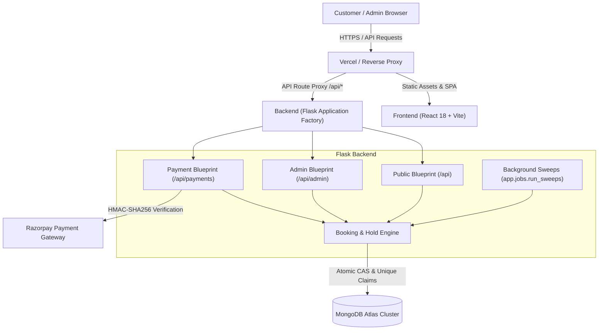

# 🎉 Joybox Party Room — Production Web Application

> **Mama Edi Mana Adda** · *Small Moments... Big Celebrations!*  
> Private, air-conditioned mini party hall beside Durga Mart, Vadlamudi, Guntur, Andhra Pradesh (522213).  
> **Host Contact:** Kiran Kumar · 📞 [+91 78427 04429](tel:+917842704429) · 💬 [WhatsApp Concierge](https://wa.me/917842704429)

---

[](.github/workflows/security_and_tests.yml)
[](backend/tests/)
[](backend/tests/)
[](backend/scripts/scan_secrets.py)
[](frontend/e2e/accessibility_audit.spec.js)
[](#license)

---

## 📖 Overview

**Joybox Party Room** is a single-venue celebration platform tailored for intimate surprise birthdays, family anniversaries, reunions, and private gatherings in Vadlamudi, Guntur. 

Traditional banquet venues in the region require cumbersome manual inquiries, lack transparent hourly pricing, and frequently suffer from overlapping bookings. Joybox solves this by providing:
1. **Interactive Real-Time Booking & Pricing:** Transparent package selection, customizable add-on boosters (bubble entry, fog machine, cold fire pyrotechnics), and instant hourly cost estimation.
2. **Atomic Conflict Prevention:** Server-authoritative slot claims backed by MongoDB compound unique constraints (`roomId`, `date`, `slotStart`) ensuring zero double-booking even under concurrent traffic spikes.
3. **Enterprise Security & Reliability:** HttpOnly, SameSite, Secure cookie-based administration with cryptographic CSRF tokens, strict rate limiting, and zero-leak credential hygiene.

---

## ✨ Key Features

### 🎊 Customer Experience
- 🎈 **Curated Celebration Packages:** Basic, Gold, and Diamond tiers with detailed inclusions and live hourly estimation.
- ⚡ **A-La-Carte Party Boosters:** Seamlessly add bubble entries, fog machines, cold fire sparks, and themed decorations.
- 📱 **Responsive Mobile First Design:** Fully optimized with custom collapsible navigation drawers across 7 distinct mobile viewports (320px to 844px).
- 🕒 **Buffer-Protected Scheduling:** Enforces a mandatory 30-minute cleaning and sanitization buffer between parties.
- 💬 **Direct WhatsApp Integration:** 1-click customer inquiries and real-time host chat support.

### 🛡️ Core Reliability & Safety
- 🔒 **Zero Double-Booking Guarantee:** Atomic 30-minute slot claims with temporary hold expiration (15-min TTL).
- 💳 **Pluggable Payment Modes:** Configurable dual-mode payments—safe "Pay at Venue" deferred workflow by default, switchable to signature-verified Razorpay Standard Web Checkout via `PAYMENTS_ENABLED`.
- 🌐 **Clean Semantic HTML & SEO:** Rich Open Graph tags, canonical URLs, Twitter cards, XML sitemaps, robots.txt, and JSON-LD `EventVenue` schema.

### 💼 Host & Administrator Console (`/admin`)
- 📊 **Executive Dashboard:** Live stats for active holds, confirmed bookings, inquiries, and revenue.
- 📅 **Manual Booking & Blackouts:** Block maintenance windows or record walk-in/offline bookings.
- 🧾 **Audit Trail:** Immutable audit logs tracking status transitions, pricing overrides, and administrative actions.
- 🔑 **Hardened Authentication:** Bcrypt password hashing (cost factor 12), brute-force account lockout (5 failed attempts / 15-min lockout), and session auto-expiry.

---

## 📸 Interface Previews

| Mobile Booking Engine (390x844) | Packages & Rates (390x844) | Location & Contact (390x844) |
|:---:|:---:|:---:|
|  |  |  |

---

## 🛠️ Tech Stack

| Domain | Technology | Purpose |
|---|---|---|
| **Frontend Framework** | React 18 (Vite 6) | Single-page application architecture |
| **Styling & Fonts** | Tailwind CSS 3, `@fontsource` | Self-hosted typography (Fredoka, Epilogue, Baloo 2, Poppins, Outfit, Noto Sans Telugu) |
| **Icons** | Material Symbols Outlined, Lucide React | Scalable vector interface icons |
| **Frontend Testing** | Vitest 5, Testing Library, Playwright | Unit, accessibility, responsive, and end-to-end testing |
| **Backend Framework** | Python 3.11 / 3.13, Flask 3.0 | Application factory, RESTful API blueprints, Marshmallow schemas |
| **Database** | MongoDB Atlas (ReplicaSet) | Document store with compound unique indexes |
| **Authentication** | Cryptographic Sessions, Bcrypt, CSRF | Secure administrative authentication & role-based access control |
| **Payment Gateway** | Razorpay Standard Checkout | Signature-verified checkout & webhooks |
| **Hosting & CI/CD** | Render, Vercel, GitHub Actions | Automated security scanning, unit tests, and production web deployment |

---

## 🏗️ System Architecture



---

## 📁 Repository Structure

```
joybox/
├── .github/workflows/          # CI/CD pipelines (Secret scanning, backend & frontend test suites)
├── backend/                    # Flask Python 3.11/3.13 backend service
│   ├── app/                    # Application factory, routes, repositories, schemas, services
│   │   ├── jobs/               # Periodic sweep jobs (run_sweeps.py)
│   │   ├── repositories/       # Mongo repository layer (mongo_repos.py)
│   │   ├── routes/             # Public, payment, and admin route blueprints
│   │   ├── schemas/            # Request validation contracts (Marshmallow)
│   │   ├── services/           # Booking engine, catalog, admin, payment services
│   │   └── utils/              # Datetime, security, and response helpers
│   ├── scripts/                # Operational CLI utilities (init_indexes, seed_all, create_admin)
│   ├── tests/                  # Pytest test suite (205 passing automated specs)
│   ├── Procfile                # Gunicorn process definition
│   ├── requirements.txt        # Production Python dependencies
│   └── run.py                  # Local development WSGI entry point
├── frontend/                   # React 18 + Vite frontend SPA
│   ├── public/                 # Static assets, self-hosted images, robots.txt, sitemap.xml
│   ├── src/                    # Components, pages, contexts, services, utilities
│   │   ├── components/         # Header (responsive mobile drawer), Footer, Guards
│   │   ├── pages/              # Landing, Packages, BookingWizard, Status, AdminConsole
│   │   └── test/               # Vitest unit test suite (29 passing specs)
│   ├── e2e/                    # Playwright end-to-end and responsive audit specs
│   └── package.json            # Node.js dependencies and scripts
├── Reports/                    # Centralized project audit and documentation repository
│   ├── audit/                  # Production audit reports and release scorecard
│   ├── docs/                   # Full operational documentation and runbooks
│   ├── mobile-audit/           # Multi-viewport mobile screenshots and overflow proofs
│   ├── archive/                # Non-production leftovers (design prototypes, legacy scripts)
│   └── INDEX.md                # Comprehensive index of relocated non-production files
├── render.yaml                 # Render Infrastructure as Code blueprint
├── pytest.ini                  # Root pytest configuration
└── README.md                   # This document
```

---

## 🚀 Quick Start Guide

### Prerequisites
- **Python:** 3.11+
- **Node.js:** 20+ & npm
- **Database:** MongoDB Atlas account with connection string

### 1. Backend Setup
```bash
# Navigate to backend directory
cd backend

# Create and activate a Python virtual environment
python -m venv .venv
# Windows PowerShell:
.venv\Scripts\Activate.ps1
# macOS/Linux:
source .venv/bin/activate

# Install dependencies
pip install -r requirements.txt

# Configure environment variables
cp .env.example .env
# Edit .env with your MongoDB Atlas URI
```

### 2. Database Initialization
```bash
# Set Python path to backend
# Windows PowerShell:
$env:PYTHONPATH="backend;."
# macOS/Linux:
export PYTHONPATH="backend:."

# Initialize atomic unique indexes and collections
python backend/scripts/init_indexes.py

# Seed master catalog (packages, add-ons, FAQs, gallery)
python backend/scripts/seed_all.py

# Create a Super Admin account
python backend/scripts/create_admin.py --username joybox_admin --role owner
```

### 3. Frontend Setup
```bash
# In a new terminal, navigate to frontend
cd frontend

# Install Node dependencies
npm install

# Configure environment variables
cp .env.example .env

# Start local Vite development server
npm run dev
```

The application will be live at `http://localhost:5173`.  
The backend API runs at `http://127.0.0.1:5000/api`.  
Admin Console is accessible directly via `http://localhost:5173/admin`.

---

## 🧪 Verification & Testing Commands

All commands below have been executed and verified in this release pass:

| Verification Stage | Command | Expected Output |
|---|---|---|
| **Backend Unit & Integration** | `python -m pytest backend/tests` | **205 passed** (100% pass rate) |
| **Frontend Unit Tests** | `npm --prefix frontend test -- --run` | **29 passed** (9 test files) |
| **Frontend Code Quality** | `npm --prefix frontend run lint` | **0 errors, 0 warnings** |
| **Production Build** | `npm --prefix frontend run build` | **Vite build clean in < 6s** |
| **Secret Scan Verification** | `python backend/scripts/scan_secrets.py` | **PASS (0 leaks detected)** |
| **Mobile Viewport E2E** | `npm --prefix frontend run test:e2e -- frontend/e2e/mobile_audit_capture.spec.js` | **All viewports passed, 0 overflow** |

---

## ☁️ Deployment Guide

### Backend Service (Render)
1. Fork or push repository to your GitHub/GitLab account.
2. In Render, create a **New Web Service** pointing to your repository, or use **Blueprint Deploy** via `render.yaml`.
3. Set the following environment variables in the Render Dashboard:
   - `MONGODB_URI`: Your MongoDB Atlas connection URI.
   - `MONGODB_DB`: `joybox_party_room`
   - `JWT_SECRET_KEY`: Long cryptographically random secret string.
   - `FRONTEND_ORIGIN`: Your production Vercel frontend URL (e.g. `https://joyboxvadlamudi.com`).
   - `ADMIN_COOKIE_SECURE`: `true`
   - `PAYMENTS_ENABLED`: `false` (set `true` once live Razorpay credentials are ready).
4. Render will execute:
   - **Build Command:** `pip install -r backend/requirements.txt`
   - **Start Command:** `gunicorn --chdir backend --workers 3 --threads 2 --timeout 120 --bind 0.0.0.0:$PORT "app:create_app()"`
   - **Health Check Path:** `/api/health`
5. The background sweep cron defined in `render.yaml` executes every 10 minutes: `python -m app.jobs.run_sweeps`.

### Frontend Service (Vercel)
1. In Vercel, import your project and set the **Root Directory** to `frontend`.
2. Framework Preset: **Vite**.
3. Set Environment Variables:
   - `VITE_API_BASE_URL`: Your Render backend production URL (e.g. `https://joybox-backend.onrender.com/api`).
   - `VITE_WHATSAPP_NUMBER`: `917842704429`
4. Deploy. Vercel automatically runs `npm run build` and distributes the SPA globally.

---

## ♿ Accessibility & Mobile Responsiveness

- **WCAG 2.2 Level AA Standard:** Passes automated Axe-core accessibility scans with 0 critical violations.
- **Color Contrast Ratios:** All text, badges, and interactive buttons comply with the minimum 4.5:1 contrast requirement for normal text and 3:1 for large text/icons.
- **Touch Target Accessibility:** All buttons, links, and form fields enforce a minimum touch target size of 44x44px.
- **Zero Horizontal Overflow:** Verified across all standardized viewports (320px iPhone SE, 360px Android, 375px iPhone 8, 390px iPhone 14, 414px XR, 768px iPad, 844px Landscape).

---

## 📄 License & Ownership

Copyright © 2026 Joybox Party Room. All rights reserved.  
Proprietary software developed exclusively for Joybox Party Room, Vadlamudi, Guntur.
