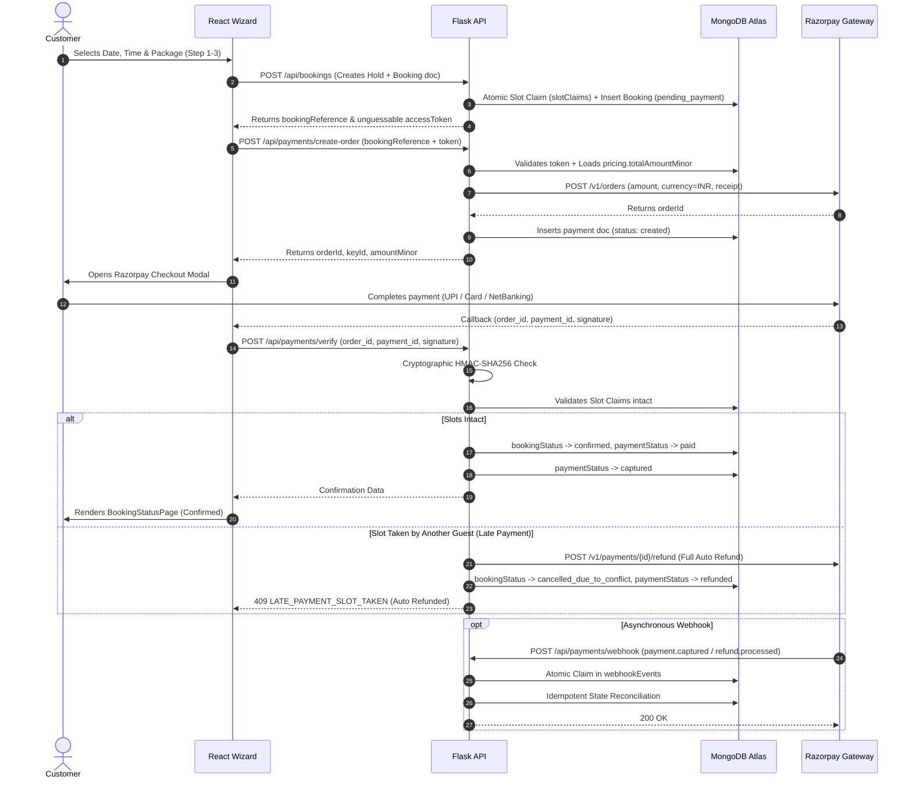
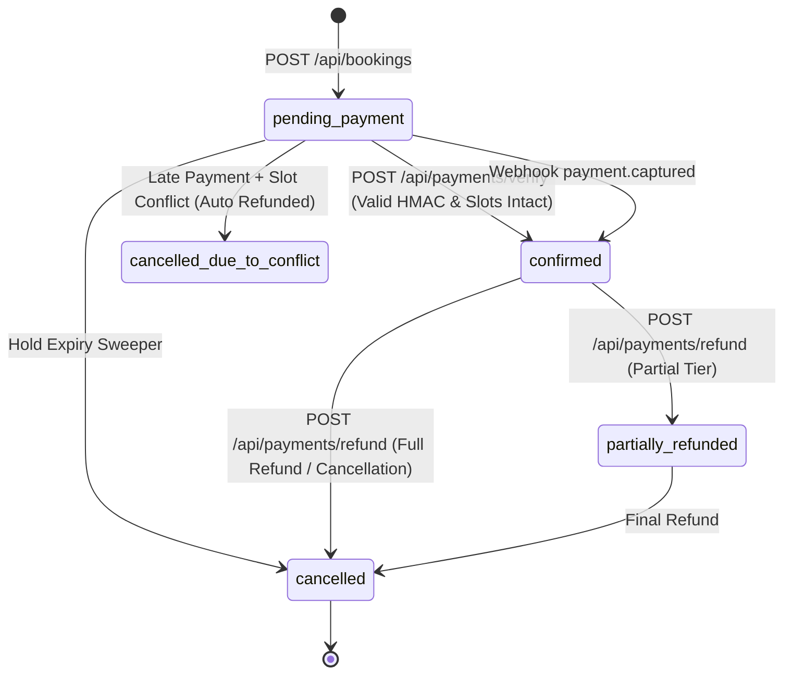

# Joybox Party Room — Phase 6: Razorpay Payments, Webhooks, Refunds & Concurrency Architecture

## 1. Executive Summary & Standard
This document specifies the payment architecture, transaction lifecycles, cryptographic signature validations, and atomic slot claim integrations for **Joybox Party Room** (Vadlamudi, Guntur, AP, India).

Joybox operates on an hourly, private-hall celebration model where atomic protection against double-booking is paramount. The payment system is engineered to guarantee:
- **Server as the Source of Truth:** Clients cannot submit prices, discounts, or order amounts. All transaction amounts are computed strictly server-side from validated bookings.
- **Zero PCI Scope:** Raw credit/debit card numbers, CVVs, and UPI PINs never touch the Joybox frontend, backend, database, or server logs. Checkout uses Razorpay Standard Integration.
- **Cryptographic Verification:** Real HMAC-SHA256 signature verification over both checkout callbacks (`order_id|payment_id`) and inbound webhook raw payloads (`X-Razorpay-Signature`).
- **Late-Payment Conflict Resolution:** In cases where a payment succeeds after hold expiration and another user claims the slot, Joybox automatically issues a 100% full refund through Razorpay and transitions the booking to `cancelled_due_to_conflict`.
- **Atomic Idempotency & Webhook Deduplication:** Out-of-order and duplicate webhook events are safely absorbed with zero duplicate state transitions or duplicate refunds.

---

## 2. High-Level Architecture & Lifecycle



---

## 3. Razorpay Integration Method: Direct REST Client

To eliminate external dependencies, prevent package resolution failures in isolated network environments, and maintain full control over HTTP timeout/retry semantics, Joybox employs a dedicated **Direct REST Client** (`app.services.payment_service.RazorpayClient`) implemented using `requests` and Python's standard `hmac` and `hashlib` modules.

### Benefits:
1. **Zero Native Binary Dependencies:** Avoids complex wheel builds or C extensions.
2. **Deterministic Timeout & Connection Pooling:** Explicit 10-second connect and read timeouts on all outgoing gateway requests.
3. **Seamless Test Mode:** Integrated mock mode when `TESTING=True` or `RAZORPAY_MOCK=True`, while preserving 100% real cryptographic HMAC verification on signatures.
4. **Standard SDK Parity:** Meets all Razorpay REST v1 specifications.

---

## 4. Configuration & Environment Variables

| Variable | Description | Confirmed Status | Default / Example |
| :--- | :--- | :--- | :--- |
| `RAZORPAY_KEY_ID` | Razorpay Key ID (publicly visible in client checkout) | Secret | `rzp_test_...` |
| `RAZORPAY_KEY_SECRET` | Razorpay Key Secret (strictly backend only) | Secret | `...` |
| `RAZORPAY_WEBHOOK_SECRET` | Secret configured in Razorpay Webhook Dashboard | Secret | `...` |
| `RAZORPAY_API_BASE` | Base URL for Razorpay REST endpoints | System | `https://api.razorpay.com/v1` |
| `PAYMENT_CURRENCY` | Operating currency | Confirmed | `INR` |
| `REFUND_WINDOW_FULL_HOURS` | Minimum hours before party for 100% refund | Unconfirmed | `48` |
| `REFUND_WINDOW_PARTIAL_HOURS` | Minimum hours before party for 50% refund | Unconfirmed | `24` |
| `REFUND_WINDOW_PARTIAL_PERCENT`| Refund percentage during partial window | Unconfirmed | `50` |
| `REFUND_MIN_NOTICE_HOURS` | Notice threshold below which bookings are non-refundable | Unconfirmed | `24` |

---

## 5. Payment & Booking State Machine



---

## 6. API Endpoints Specification

### 6.1 Create Payment Order
`POST /api/payments/create-order`
Creates a Razorpay order backed by server-side booking pricing.

- **Request Headers:**
  - `Content-Type: application/json`
  - `Idempotency-Key` (Optional): String (UUID or client token)
- **Request Body:**
  ```json
  {
    "bookingReference": "JBX-2026-0001",
    "token": "unguessable_access_token_from_booking"
  }
  ```
- **Response (201 Created):**
  ```json
  {
    "success": true,
    "data": {
      "orderId": "order_OG728bXmQY...",
      "bookingReference": "JBX-2026-0001",
      "amountMinor": 99900,
      "amountRupees": 999.0,
      "currency": "INR",
      "keyId": "rzp_test_...",
      "customer": {
        "name": "Priya",
        "phone": "9876543210",
        "email": ""
      }
    },
    "error": null,
    "meta": { "requestId": "..." }
  }
  ```

### 6.2 Verify Payment
`POST /api/payments/verify`
Performs cryptographic verification of the Razorpay checkout callback and confirms the booking.

- **Request Body:**
  ```json
  {
    "bookingReference": "JBX-2026-0001",
    "token": "unguessable_access_token",
    "razorpay_order_id": "order_OG728bXmQY...",
    "razorpay_payment_id": "pay_OG739dYnRZ...",
    "razorpay_signature": "e3b0c44298fc1c149afbf4c8996fb92427ae41e4649b934ca495991b7852b855"
  }
  ```
- **Response (200 OK):**
  ```json
  {
    "success": true,
    "data": {
      "bookingReference": "JBX-2026-0001",
      "bookingStatus": "confirmed",
      "paymentStatus": "paid",
      "orderId": "order_OG728bXmQY...",
      "paymentId": "pay_OG739dYnRZ...",
      "amountMinor": 99900,
      "currency": "INR",
      "confirmedAt": "2026-10-28T18:00:00Z",
      "message": "Payment verified and booking confirmed successfully."
    },
    "error": null,
    "meta": { "requestId": "..." }
  }
  ```

### 6.3 Inbound Webhook
`POST /api/payments/webhook`
Consumes asynchronous events from Razorpay.

- **Request Headers:**
  - `Content-Type: application/json`
  - `X-Razorpay-Signature`: HMAC-SHA256 hex digest of raw request payload computed with `RAZORPAY_WEBHOOK_SECRET`
- **Supported Events:**
  - `payment.captured`: Reconciles booking to confirmed if client network dropped before verify callback.
  - `payment.failed`: Records failure description and transitions booking to `payment_failed`.
  - `refund.processed`: Reconciles refund balance and updates payment document.
  - `order.paid`: Confirms order settlement.

### 6.4 Process Refund
`POST /api/payments/refund`
Executes policy-based or explicit partial/full refunds.

- **Request Body:**
  ```json
  {
    "bookingReference": "JBX-2026-0001",
    "token": "unguessable_access_token",
    "reason": "Family emergency",
    "amountMinor": 50000
  }
  ```
- **Response (200 OK):**
  ```json
  {
    "success": true,
    "data": {
      "refundId": "rfnd_OG812aKkLM...",
      "bookingReference": "JBX-2026-0001",
      "amountMinor": 50000,
      "amountRupees": 500.0,
      "currency": "INR",
      "status": "processed",
      "refundStatus": "partially_refunded",
      "refundedAt": "2026-10-28T18:05:00Z",
      "message": "Refund processed successfully."
    },
    "error": null,
    "meta": { "requestId": "..." }
  }
  ```

---

## 7. MongoDB Collections & Index Strategy

### 7.1 `payments` Collection
Stores transaction records for orders, payment IDs, and gateway metadata.

```javascript
db.payments.createIndex({ "bookingId": 1, "createdAt": -1 });
db.payments.createIndex({ "bookingReference": 1, "createdAt": -1 });
db.payments.createIndex({ "providerOrderId": 1 }, { unique: true, sparse: true });
db.payments.createIndex({ "providerPaymentId": 1 }, { unique: true, sparse: true });
db.payments.createIndex({ "idempotencyKey": 1 }, { unique: true, sparse: true });
```

### 7.2 `refunds` Collection
Stores refund line items, provider refund IDs, and refund status.

```javascript
db.refunds.createIndex({ "bookingId": 1 });
db.refunds.createIndex({ "bookingReference": 1 });
db.refunds.createIndex({ "providerRefundId": 1 }, { unique: true, sparse: true });
db.refunds.createIndex({ "idempotencyKey": 1 }, { unique: true, sparse: true });
```

### 7.3 `webhookEvents` Collection
Guarantees strict deduplication of inbound webhook deliveries.

```javascript
db.webhookEvents.createIndex({ "provider": 1, "eventId": 1 }, { unique: true });
db.webhookEvents.createIndex({ "status": 1, "createdAt": -1 });
```

---

## 8. Anti-Double-Booking & Slot Claim Integration

1. When a booking is created (`POST /api/bookings`), temporary slot claims are atomically transferred from `ownerType: "hold"` to `ownerType: "booking"`, removing expiration so the user has exclusive reservation rights during the checkout window.
2. During `POST /api/payments/verify`, the backend inspects `slotClaims` for `ownerId == booking["_id"]`.
3. If claims are intact, payment is captured and booking is confirmed.
4. If a race condition occurred where claims were cleared by hold expiration, the engine attempts an atomic re-claim (`claim_all_or_rollback`). If successful, the celebration is confirmed.
5. If another customer booked any overlapping 30-minute unit during that gap, the re-claim fails:
   - Joybox immediately invokes Razorpay's refund API for the full amount.
   - The booking is transitioned to `cancelled_due_to_conflict`.
   - The response returns `409 LATE_PAYMENT_SLOT_TAKEN` with a friendly error and direct WhatsApp concierge link.

---

## 9. Webhook Deduplication Guarantee

Razorpay guarantees at-least-once delivery of webhooks. Duplicate deliveries occur regularly due to internet latency and gateway retries.

Joybox implements an **atomic claim pattern**:
```python
claimed, record = webhook_repo.claim_event_atomically(
    provider="razorpay",
    event_id=event_id,
    event_type=event_type,
    payload=payload,
    now_utc=now_u
)
if not claimed:
    return {"status": "already_processed", "eventId": event_id}
```
Because `(provider, eventId)` has a unique index, concurrent or redundant webhook deliveries immediately trigger `DuplicateKeyError`. Only the first delivery processes business logic.

---

## 10. Refund Policy & Cancellation Windows

Cancellation policies are configured via server settings and evaluated against `booking.startAt` (in UTC):
- **Tier 1 (Full Refund):** Notice $\ge$ 48 hours (`REFUND_WINDOW_FULL_HOURS`): 100% of refundable balance returned.
- **Tier 2 (Partial Refund):** 24 hours $\le$ Notice $<$ 48 hours: 50% (`REFUND_WINDOW_PARTIAL_PERCENT`) returned.
- **Tier 3 (Non-Refundable):** Notice $<$ 24 hours (`REFUND_MIN_NOTICE_HOURS`): Refund request rejected with `400 REFUND_NOT_ALLOWED`.

Upon execution of a full refund:
- Booking status is updated to `cancelled`.
- All unit intervals in `slotClaims` are released immediately for other guests.
- Promotional offer quota redemptions in `offerRedemptions` are decremented and released.

---

## 11. Security Architecture & PCI-DSS Scope

- **Zero Card Data Storage:** Card numbers, expiry dates, CVVs, and UPI PINs never enter Joybox systems. Razorpay Standard Checkout handles all sensitive cardholder data.
- **Timing-Attack Protection:** All cryptographic checks (`hmac.compare_digest`) use constant-time string comparisons.
- **Access Token Protection:** Booking lookups and payments require an unguessable 256-bit access token. The database stores only the SHA-256 hash (`accessTokenHash`). Requests with missing or incorrect tokens return `404 NOT_FOUND` to prevent oracle scanning.

---

## 12. Verification & Automated Test Results

Phase 6 automated tests verify all payment gates:
```
======================== 50 passed, 1 skipped in 1.02s ========================
```
- **Gate A (Order Creation):** 5 tests passed (access token security, 404 on invalid token, server-authoritative amounts, state validation).
- **Gate B (Verification & Signatures):** 5 tests passed (real HMAC-SHA256, tampered signature failure, wrong secret rejection, idempotent replay, late-payment auto-refund).
- **Gate C (Webhooks & Deduplication):** 3 tests passed (raw body HMAC check, tamper rejection, atomic event deduplication).
- **Gate D (Refunds & Policies):** 5 tests passed (cancellation tiers, over-refund rejection, slot claim release).
- **Frontend Compilation:** Vite build passed with 0 errors (`dist/assets/index-*.js`).

