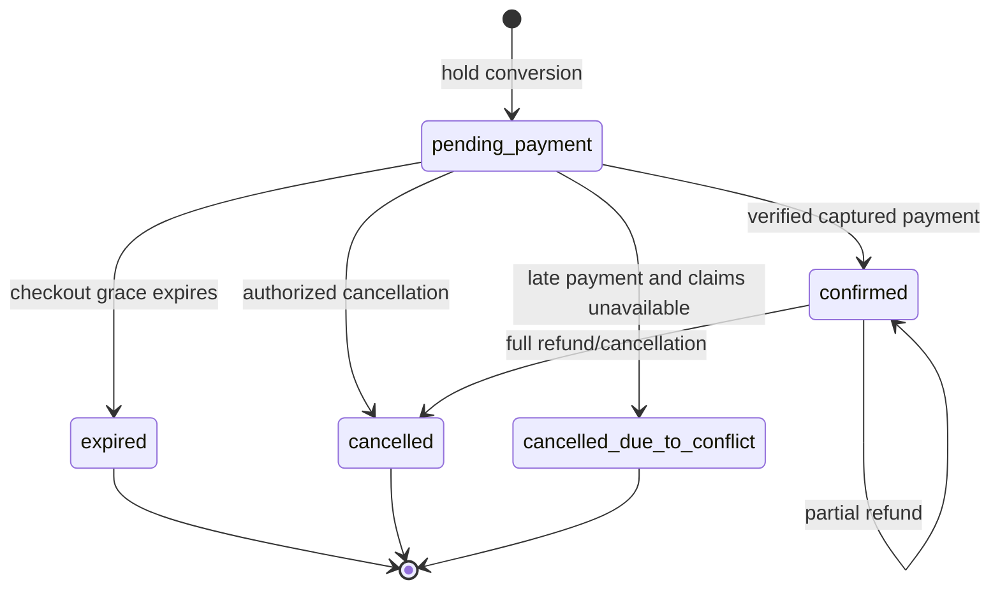
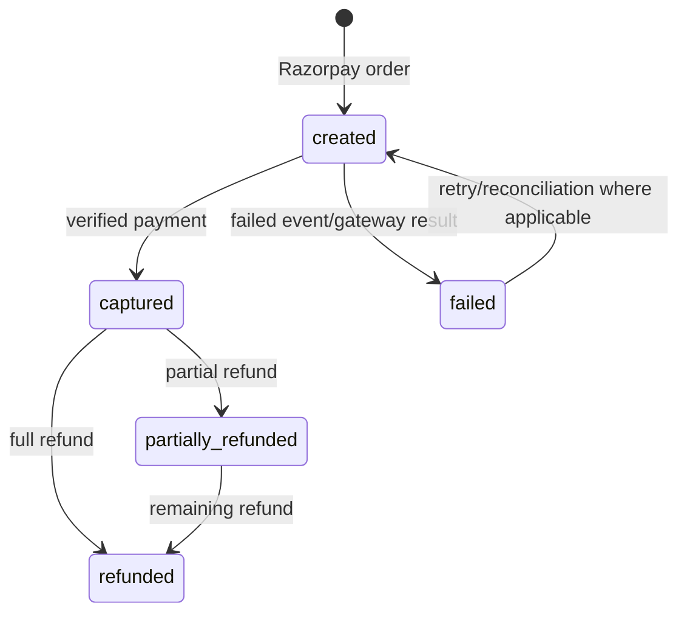
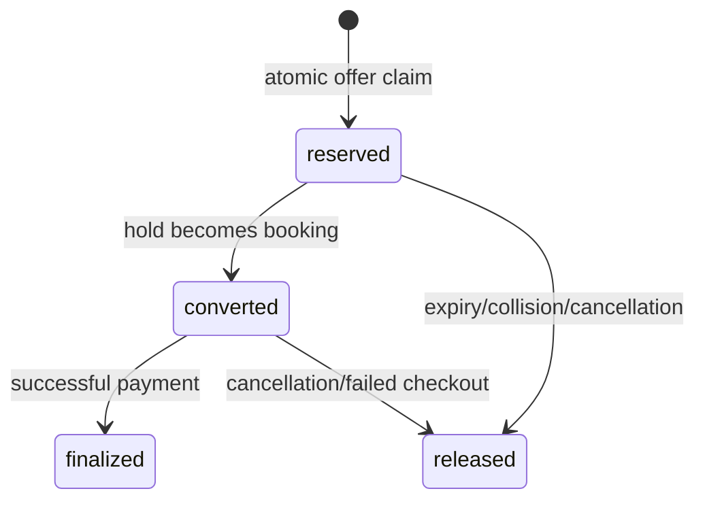
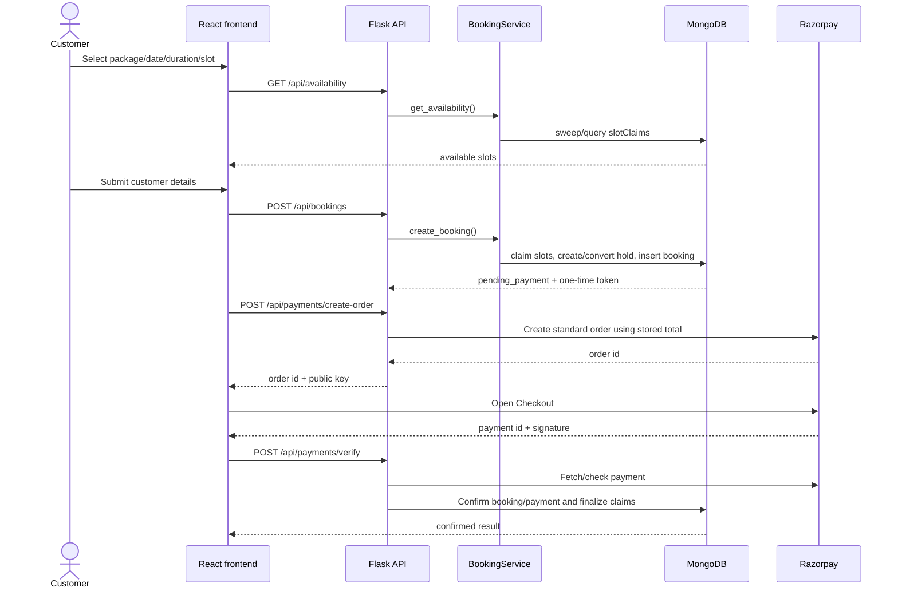
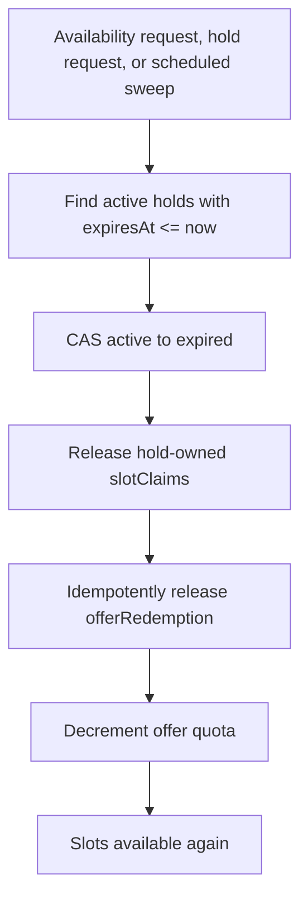
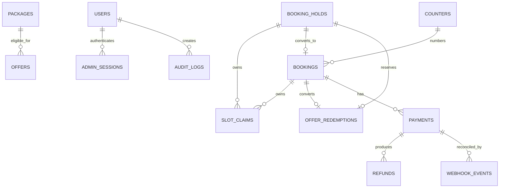

# Joybox Party Room - Project Logic Documentation

> **Audit basis:** source and configuration reviewed on 2026-10-30. This document describes implemented behavior, not an idealized design. Paths are relative to the repository root. Secrets, tokens, customer data, and live configuration values are intentionally omitted.

## Table of Contents

1. [Project Overview](#1-project-overview)
2. [Technology and Architecture](#2-technology-and-architecture)
3. [Directory and Component Responsibilities](#3-directory-and-component-responsibilities)
4. [End-to-End Customer Journey](#4-end-to-end-customer-journey)
5. [Booking Lifecycle](#5-booking-lifecycle)
6. [Availability and Slot Reservation](#6-availability-and-slot-reservation)
7. [Pricing and Quotes](#7-pricing-and-quotes)
8. [Holds and Expiration](#8-holds-and-expiration)
9. [Razorpay Payments](#9-razorpay-payments)
10. [Offers and Redemptions](#10-offers-and-redemptions)
11. [Customer Access and Admin Authentication](#11-customer-access-and-admin-authentication)
12. [Admin Functionality](#12-admin-functionality)
13. [Database Schema and Relationships](#13-database-schema-and-relationships)
14. [API Endpoint Inventory](#14-api-endpoint-inventory)
15. [State Machines](#15-state-machines)
16. [Idempotency, Concurrency, and Transactions](#16-idempotency-concurrency-and-transactions)
17. [Error Handling and Recovery](#17-error-handling-and-recovery)
18. [Security Implementation](#18-security-implementation)
19. [Configuration and Environment](#19-configuration-and-environment)
20. [Logging and Background Jobs](#20-logging-and-background-jobs)
21. [Visual Workflows](#21-visual-workflows)
22. [Findings and Recommendations](#22-findings-and-recommendations)
23. [Testing and Validation](#23-testing-and-validation)
24. [Unverified Areas and Glossary](#24-unverified-areas-and-glossary)

## 1. Project Overview

Joybox Party Room is a single-room celebration venue booking application. Customers browse packages, add-ons, offers, gallery content, and FAQs; select an IST date and hourly slot; submit customer details; create a pending-payment booking; and pay through Razorpay Checkout. Customers can later retrieve a minimal booking status publicly or full safe details with a booking access token.

Administrators use a React console backed by cookie-based server sessions. The backend supports dashboard metrics, booking operations, catalog maintenance, availability blocks, inquiry management, payment inspection/refund retry, and audit-log inspection.

The application uses a temporary hold and 30-minute slot-claim model to prevent double booking. MongoDB unique indexes provide the central collision guard. Cleanup is available both lazily on availability/hold access and through `python -m app.jobs.run_sweeps`.

## 2. Technology and Architecture

### Stack

| Area | Implementation |
|---|---|
| Frontend | React 18, React Router, Vite, Tailwind CSS, `lucide-react` |
| Backend | Flask application factory and blueprints |
| Database | MongoDB through PyMongo |
| Payments | Razorpay Standard Checkout and direct REST API calls |
| Validation | Marshmallow request schemas |
| Time | `Asia/Kolkata` for business rules; UTC persistence/claims |
| Deployment | Render backend configuration and Vercel frontend configuration are present |

### Request path

`frontend/src/pages` and `frontend/src/services` call Flask blueprints. Routes validate request data, construct repositories and services, and return a common JSON envelope from `backend/app/utils/responses.py`. Services calculate business outcomes; repositories perform MongoDB operations.

`backend/app/__init__.py:create_app` configures logging, request IDs, `ProxyFix`, CORS, security headers, MongoDB, and blueprints. The public blueprint has prefix `/api`, the payment blueprint has `/api/payments`, and the admin blueprint has `/api/admin`.

The backend can start without a configured database; health reports `not_configured`, while most persistence operations then fail explicitly. Startup configuration rejects legacy MongoDB variable names and rejects live Razorpay keys in development/test mode.

## 3. Directory and Component Responsibilities

### Backend

| Path | Responsibility |
|---|---|
| `backend/app/__init__.py` | Application factory, CORS, headers, request IDs, error handlers |
| `backend/app/config.py` | Environment loading and business/security defaults |
| `backend/app/extensions.py` | MongoClient creation and application extension registration |
| `backend/app/routes/public_routes.py` | Catalog, quote, availability, inquiry, booking, legacy payment entry points |
| `backend/app/routes/payment_routes.py` | Canonical order, verification, webhook, and refund endpoints |
| `backend/app/routes/admin_routes.py` | Admin auth, operations, catalog, metrics, payments, audit routes |
| `backend/app/services/booking_service.py` | Availability, pricing, holds, booking conversion, lookup, cancellation |
| `backend/app/services/payment_service.py` | Razorpay calls, verification, webhooks, refunds, payment/booking transitions |
| `backend/app/services/catalog_service.py` | Active catalog retrieval and quote calculation |
| `backend/app/services/admin_service.py` | Password authentication, sessions, CSRF, role checks |
| `backend/app/repositories/mongo_repos.py` | Collection-specific reads, writes, compare-and-set updates, counters |
| `backend/app/schemas/*.py` | Marshmallow request contracts |
| `backend/app/utils/datetime_utils.py` | IST parsing, UTC conversion, window and interval validation |
| `backend/app/jobs/run_sweeps.py` | Scheduled hold, booking, claim, offer, and payment maintenance |

### Frontend

| Path | Responsibility |
|---|---|
| `frontend/src/App.jsx` | Public/admin route table |
| `frontend/src/services/api.js` | Shared public API client and error normalization |
| `frontend/src/services/adminApi.js` | Credentialed admin API client and CSRF header |
| `frontend/src/services/razorpay.js` | Checkout script loading, order creation, signature verification |
| `frontend/src/pages/BookingWizardPage.jsx` | Four-step booking and payment flow |
| `frontend/src/pages/BookingStatusPage.jsx` | Booking lookup, payment, and cancellation UI |
| `frontend/src/pages/AdminConsolePage.jsx` | Admin operations UI |
| `frontend/src/components/AdminProtectedRoute.jsx` | Admin session provider and route guard |
| `frontend/src/pages/PackagesPage.jsx`, landing pages | Catalog, offer, and quote presentation |

## 4. End-to-End Customer Journey

1. The React router loads a public page.
2. Catalog pages request active packages, add-ons, and offers.
3. The booking wizard initializes package, duration, and tomorrow's IST date, or reads query parameters.
4. Date/duration changes call `GET /api/availability`; changing either clears the selected slot.
5. The customer enters phone and celebration details.
6. `POST /api/bookings` creates a hold internally when no `holdId` is supplied, claims the event and buffer intervals, converts the hold, and creates a `pending_payment` booking.
7. The response contains a one-time raw access token. The wizard stores it in session storage under a booking-specific key.
8. `POST /api/payments/create-order` derives the amount from the booking, not the browser, and returns a Razorpay order.
9. Razorpay Checkout opens with the returned order ID and public key ID.
10. The Checkout handler sends the order ID, payment ID, signature, booking reference, and access token to `/api/payments/verify`.
11. The backend validates the signature and gateway payment details, then confirms the booking or performs late-payment conflict handling.
12. The frontend navigates to `/booking/:reference`; the status page uses the stored token for full details and payment/cancellation actions.

## 5. Booking Lifecycle

### Hold-to-booking processing

The canonical direct booking path is `BookingService.create_booking`:

1. Validate idempotency, if a key is supplied.
2. If no `holdId` is present, call `create_hold`.
3. Validate that the hold is active and not expired.
4. Allocate a yearly sequence from `counters` and create `JBX-YYYY-NNNN`.
5. Generate a random access token and store only its SHA-256 hash.
6. Compare-and-set the hold from `active` to `converted`.
7. Transfer slot claims from hold ownership to booking ownership and set checkout expiry.
8. Convert the offer redemption from hold to booking.
9. Insert the booking snapshot with `bookingStatus: pending_payment` and `paymentStatus: unpaid`.
10. Complete idempotency with the response containing the raw token.

The hold payload contains room, package, duration, date/time, UTC start/end/buffer times, selected add-ons, pricing, customer data, celebrant details, a UUID session token, and expiry.

### Booking state table

| Current state | Trigger and conditions | Next state | Database effects | Failure handling |
|---|---|---|---|---|
| Hold `active` | Valid conversion request before `expiresAt` | `converted` | Hold CAS update; claims transferred; offer reservation converted; booking inserted | Expiry releases claims/promo; failed multi-step operations rely on compensating cleanup |
| Hold `active` | Expiry or explicit stale access | `expired` | Hold CAS; claims released; promo reservation released | Idempotent release prevents repeated quota decrement |
| Booking `pending_payment` | Verified captured payment and valid claims | `confirmed` | Booking/payment CAS updates; claim expiry removed; promo finalized | Late conflict triggers refund and terminal conflict state |
| Booking `pending_payment` | Checkout grace expires without captured/authorized payment | `expired` | Booking CAS; claims and promo released | Scheduled sweep retries/reconciles |
| Booking `pending_payment` | Customer cancellation, where allowed | `cancelled` | Status update; claims and promo released | CAS prevents duplicate cancellation |
| Booking `confirmed` | Authorized cancellation/refund | `cancelled` when full refund; otherwise remains active for partial refund | Refund/payment updates and claim release for full cancellation | Gateway failure creates reviewable refund state |
| Booking `pending_payment` or `confirmed` | Payment succeeds after claims disappeared | `cancelled_due_to_conflict` | Automatic full refund attempt; payment marked refunded if successful; claims cannot be restored | `LatePaymentSlotTakenError`; failed refund requires review |
| Booking terminal | Admin/status workflows | Varies by allowed role and validation | Audit record is written for admin actions | Invalid state returns a structured error |

`paymentStatus` is separate from `bookingStatus`; observed values include `unpaid`, `paid`, `partially_refunded`, and `refunded`.

## 6. Availability and Slot Reservation

### Rules

- Time zone: `Asia/Kolkata`.
- Operating hours: 09:00 through 22:00 IST.
- Duration: integer 1 through 6 hours.
- Start must be exactly on the hour and not in the past.
- Party end must be no later than 22:00.
- A 30-minute post-party buffer is claimed.
- Claims are generated in 30-minute units.
- Default room is `main`.

`get_availability` enumerates hourly starts from opening through the latest start that fits the requested duration. It first sweeps expired holds, then queries overlapping active claims. Each slot contains UTC ISO start/end values and is marked `past`, `booked`, `hold`, `buffer`, or `unavailable` when blocked.

### Reservation algorithm

1. Parse the requested IST date/time and convert to UTC.
2. Generate event intervals `[start, end)` and buffer intervals `[end, end+30m)`.
3. Reclaim expired holds targeting the same slot starts.
4. Insert all claims sequentially under the hold owner.
5. A unique `(roomId, slotStart)` index rejects a collision.
6. On insertion failure, delete claims inserted by that attempt.
7. Insert the hold document with the configured hold expiry.
8. On hold conversion, transfer ownership and replace hold expiry with checkout expiry.
9. On confirmation, remove claim expiry; on cancellation/expiry, release by owner.

Example: for an illustrative booking on **2026-11-05 at 10:00 IST for 2 hours**, the event claims are 10:00-10:30, 10:30-11:00, 11:00-11:30, and 11:30-12:00 IST; the buffer claim is 12:00-12:30 IST. A second request for 11:00 overlaps an event claim; a request for 12:00 overlaps the buffer.

Availability is an advisory read. Actual reservation is protected by unique claim insertion; the read itself does not reserve anything.

## 7. Pricing and Quotes

Pricing is authoritative on the backend (`BookingService._compute_price_quote` and `CatalogService.calculate_quote`). Database package and add-on records are used; frontend amounts are not trusted.

```text
baseAmountMinor = package.pricePerHourMinor * durationHours
addOnsAmountMinor = sum(selected add-on priceMinor)
discountAmountMinor = max(0, package.pricePerHourMinor - offer.promoPricePerHourMinor) * durationHours
totalAmountMinor = max(0, baseAmountMinor + addOnsAmountMinor - discountAmountMinor)
taxAmountMinor = 0
```

The service rejects inactive/missing packages and add-ons, and rejects an add-on already listed in `includedAddOnCodes`. Promotional pricing is package-specific, active-only, and limited by `monthlyRedemptionCount < monthlyLimit`. The final booking snapshots line items and amounts. No tax is currently added.

Illustrative calculation using sample values: a package at 150,000 minor units/hour for 2 hours plus a 20,000-unit add-on, with a promotional price of 125,000/hour, gives `300,000 + 20,000 - 50,000 = 270,000` minor units (INR 2,700). This is an example of the formula, not a live catalog value.

`PaymentService.create_order` reads `booking.pricing.totalAmountMinor`; the browser cannot change the payment amount through the order request. The frontend does contain hard-coded presentation prices in landing and wizard components, so displayed catalog values can drift from the database, but the payable backend amount remains authoritative.

## 8. Holds and Expiration

Holds temporarily protect claims while the customer reaches booking/payment. The configured default is 10 minutes and is marked unconfirmed in source comments. `create_hold` reserves promo quota before claim insertion when eligible, then compensates if claims collide. If claims succeed but hold insertion fails, the operation is not a MongoDB transaction; TTL, sweeps, or reconciliation are the remaining cleanup mechanisms.

`BookingService.sweep_expired_holds` finds active holds whose `expiresAt` is past, changes them to `expired` with a conditional update, releases claims, and idempotently releases offer reservations. Availability and hold creation perform lazy sweeps. `run_sweeps` performs the same maintenance as a scheduled/cron-capable process.

Bookings receive a separate checkout grace expiry (default 15 minutes). The scheduled job expires pending bookings whose checkout expiry or fallback creation age has passed, except when the latest payment is already captured/authorized/paid. It releases claims and reserved offers. A janitor also detects pending bookings whose claims disappeared.

## 9. Razorpay Payments

### Order and Checkout flow

1. Client sends booking reference and token to `POST /api/payments/create-order`.
2. Service authenticates the booking token and rejects invalid/cancelled/already-paid bookings.
3. Service reads the stored total and creates a standard Razorpay order through `RazorpayClient.create_order`.
4. The payment record stores provider/order/booking/amount/currency/status metadata.
5. Checkout expiry and claims may be extended, bounded by configured maximums.
6. Frontend loads `https://checkout.razorpay.com/v1/checkout.js`, supplies the returned public key ID and order ID, and opens Standard Checkout.
7. Checkout returns `razorpay_order_id`, `razorpay_payment_id`, and `razorpay_signature`.
8. Client sends them to `/api/payments/verify`.
9. Backend verifies HMAC-SHA256 over `order_id|payment_id` using the server secret.
10. Backend fetches the payment and checks order ID, amount, INR currency, and captured/acceptable state.
11. A compare-and-set service workflow confirms the payment/booking and makes claims non-expiring.

The frontend label mentions UPI/Card, but the code does not disable other provider-enabled methods and does not prove account-level availability. The backend creates standard orders; no payment configuration ID is supplied in the inspected code.

### Payment data model

Observed fields include payment `_id`, `bookingId`, `bookingReference`, `provider`, `providerOrderId`, `providerPaymentId`, `amountMinor`, `currency`, `status`, receipt/notes, idempotency key, gateway/error details, timestamps, and refund-related status fields. Refunds have booking/provider payment references, provider refund ID, amount/status, idempotency key, timestamps, and error information. Exact optional fields vary by path.

### Payment state table

| Current state | Event and validation | Next state | Booking impact | Retry |
|---|---|---|---|---|
| No order | Authenticated booking; stored amount | Payment `created`, Razorpay order created | Booking remains pending payment | Same idempotency key replays |
| Payment `created` | Valid signature, matching order/amount/currency, captured gateway payment | Payment `captured`; booking `confirmed`/`paid` | Claims become permanent | Duplicate verification is replay-safe |
| Payment `created` | Gateway reports failure | Payment failed or retained failure details | Booking remains pending until expiry | Webhook/reconciliation can retry |
| Pending booking | Claims gone at successful verification | Payment refunded; booking `cancelled_due_to_conflict` | Automatic refund attempted | Failed refund is reviewable |
| Paid | Valid refund request within refundable balance | `refunded` or `partially_refunded` | Full refund cancels/releases; partial refund leaves booking active | Refund idempotency and retry endpoint |
| Webhook unseen | Valid signature and new `(provider,eventId)` | Processed event | Applies captured/paid/failed/refund effects | Duplicate event returns already processed |

`/api/payments/verify-payment` and public `/api/verify-payment` are compatibility aliases. The canonical frontend uses `/api/payments/verify`.

## 10. Offers and Redemptions

Active offers are returned by `GET /api/offers/active` and selected by package code. A quote may show a discount if the offer's monthly count is below its limit. At hold creation, `OfferRepository.atomic_claim_slot` uses a conditional update/increment; the resulting `offerRedemptions` document starts as `reserved` and references the hold and IST period key.

On hold conversion, the redemption references the booking and remains reserved/converted according to repository implementation. On confirmation it is finalized. Expiry, cancellation, collision rollback, and abandoned checkout use idempotent release and decrement the offer count. A concurrent last-slot claim either wins atomically or recomputes the quote without the promotion.

No separate monthly reset job was found; the counter is keyed/maintained by the offer's stored monthly fields and period handling. The owner-facing business policy for quotas remains configuration/data dependent.

## 11. Customer Access and Admin Authentication

### Customer access

Customer authentication is booking-specific, not JWT-based. The booking response returns a random access token once; only its SHA-256 hash is stored in the booking. Lookup without a token returns minimal reference/status/payment fields. A valid token returns safe booking details. Invalid tokens are intentionally indistinguishable from unknown references and follow a 404-style path. Cancellation requires the token and a conditional booking-state update.

The frontend stores the raw token in `sessionStorage`, which limits persistence to the browser session but means same-origin JavaScript can access it.

### Admin access

`AdminService` verifies bcrypt passwords (with compatibility fallbacks), performs dummy verification for unknown users, tracks failures and lockout, and creates a random session token. Only the SHA-256 session-token hash is stored in `adminSessions`. Sessions include user/role, CSRF token, creation/access/expiry timestamps, idle expiry, user-agent/IP, and revocation data.

The token is sent in an HttpOnly cookie scoped to `/api/admin`; production enables `Secure`, and SameSite defaults to `Lax`. Mutating admin routes require the stored CSRF token in `X-CSRF-Token`. `require_admin_session` validates expiry, idle timeout, revocation, and user; `require_role` enforces roles.

## 12. Admin Functionality

| Area | Routes | Authorization |
|---|---|---|
| Authentication | login, logout, me, change-password | Session; change password also CSRF |
| Dashboard | `GET /dashboard` | Session |
| Bookings | list, detail, patch, manual create | Session; updates staff/manager/owner; manual create manager/owner |
| Availability blocks | list/create/delete | Session; create/delete manager/owner |
| Packages | list/create/update | Create owner; update manager/owner |
| Add-ons | list/create/update | Manager/owner for mutation |
| Inquiries | list/update | Session and CSRF for mutation |
| Payments | list/retry refund | Manager/owner |
| Audit | list | Manager/owner |

Admin services persist audit events for administrative actions. Dashboard values are derived from current bookings/payments and are not an independent reporting warehouse. Customer management, reviews, notifications, file uploads, and a general reports API were not found as implemented workflows.

## 13. Database Schema and Relationships

The following collections are instantiated by application repositories. Collection names are case-sensitive as shown:

| Collection | Purpose and key fields |
|---|---|
| `packages` | Active catalog; `code`, name, hourly minor price, included add-on codes |
| `addOns` | Active add-ons; code, name, minor price |
| `offers` | Package promotions; active flag, promo hourly price, monthly limit/count |
| `inquiries` | Contact submissions and admin status |
| `bookingHolds` | Temporary reservation snapshot, owner/room/time, expiry, status, session token |
| `slotClaims` | 30-minute event/buffer claims; room, slot range, owner type/id, expiry |
| `bookings` | Historical booking snapshot, reference, token hash, pricing, status, payment status, times |
| `counters` | Atomic yearly booking-reference sequence |
| `offerRedemptions` | Reserved/converted/released promo allocations linked to hold or booking |
| `idempotencyKeys` | Endpoint/key/request hash, in-progress/completed response, expiry |
| `rateLimits` | Counter/window records for IP, phone, inquiry, and login limits |
| `payments` | Razorpay order/payment state and amounts |
| `refunds` | Provider refund attempts, status, amount, error, idempotency |
| `webhookEvents` | Provider event deduplication and processing result |
| `users` | Admin users, password hashes, role, lockout fields |
| `adminSessions` | Hashed admin session token and CSRF/session metadata |
| `auditLogs` | Admin actor/action/target/audit details |
| `availabilityBlocks` | Admin-created unavailable room/time blocks |
| `galleryAssets` | Public gallery metadata; `storageKey` is removed from public response |
| `faqs` | Public active FAQ records |

Relationships are by MongoDB ObjectId and business references: holds own claims through `ownerId`; claims transfer to bookings; redemptions point to a hold or booking; payments and refunds point to bookings/provider IDs; counters produce references; webhook events deduplicate provider events.

### Indexes and consistency

`backend/scripts/init_indexes.py` defines unique booking references, unique room/slot claims, sparse unique payment/provider IDs, unique webhook provider/event IDs, unique endpoint/key idempotency records, sparse hold/booking redemption IDs, TTL indexes for expiring records, and supporting query indexes. The unique `(roomId, slotStart)` claim index is the central anti-double-booking guard.

`database/indexes.js` and `database/validators.js` are inconsistent starter scripts: they use fields such as `status`/`venueId` that differ from application `bookingStatus`/`roomId`, omit the critical unique claim index, and do not cover all operational collections. The Python initializer should be treated as the implementation-aligned source until these scripts are reconciled.

## 14. API Endpoint Inventory

All responses use the standard success/error envelope unless an explicit compatibility path differs.

| Method | Endpoint | Purpose | Auth | Main request | Main response/effects |
|---|---|---|---|---|---|
| GET | `/api/health` | Health and DB ping | Public | None | Status; no DB write |
| GET | `/api/packages` | Active packages | Public | None | Items, INR |
| GET | `/api/packages/<slug>` | One active package | Public | Path code | Package or 404 |
| GET | `/api/add-ons` | Active add-ons | Public | None | Items, INR |
| GET | `/api/offers/active` | Active offers | Public | None | Offers |
| GET | `/api/gallery` | Active gallery | Public | Optional category | Items, strips `storageKey` |
| GET | `/api/faqs` | Active FAQs | Public | Optional category | Items |
| POST | `/api/bookings/quote` | Authoritative quote | Public | package, duration, add-ons, promo flag | Line items and total; no write |
| POST | `/api/inquiries` | Submit inquiry | Public/rate-limited | Name, phone, optional details | Created inquiry |
| GET | `/api/availability` | Slot availability | Public | date, duration, room | Slot list; lazy cleanup |
| POST | `/api/bookings/hold` | Create temporary hold | Public/rate-limited | Booking details | Hold, pricing, claims, promo reservation |
| POST | `/api/bookings` | Create pending-payment booking | Public/token via hold | `holdId` or booking data | Reference, one-time token, booking |
| GET | `/api/bookings/<reference>` | Lookup booking | Public/token optional | Query token | Minimal or full safe data |
| POST | `/api/bookings/<reference>/cancel` | Cancel booking | Booking token | token, reason | Status; releases |
| POST | `/api/payments/create-order` | Create/reuse Razorpay order | Booking token | reference, token, optional idempotency | Order/payment record |
| POST | `/api/payments/verify` | Verify Checkout payment | Booking token | reference/token/order/payment/signature | Confirmation or conflict/refund |
| POST | `/api/payments/verify-payment` | Payment alias | Booking token | Same as verify | Same |
| POST | `/api/payments/webhook` | Process Razorpay event | Signature | Raw JSON + signature header | Event result and updates |
| POST | `/api/payments/refund` | Customer-token refund | Booking token | reference, token, reason, amount | Refund/payment/booking updates |
| POST | `/api/create-order` | Legacy public order entry | See route implementation | Order payload | Payment service result |
| POST | `/api/verify-payment` | Legacy public verify entry | See route implementation | Verification payload | Payment service result |
| POST | `/api/admin/auth/login` | Admin login | Public, rate-limited | Username/password | User, CSRF; HttpOnly cookie |
| POST | `/api/admin/auth/logout` | Revoke session | Admin cookie | None | Cookie deletion and revocation |
| GET | `/api/admin/auth/me` | Current admin | Admin cookie | None | User and CSRF token |
| POST | `/api/admin/auth/change-password` | Change password | Admin + CSRF | Old/new password | Confirmation |
| GET | `/api/admin/dashboard` | KPI metrics | Admin | None | Dashboard data |
| GET/PATCH/POST | `/api/admin/bookings[/<ref>]` | List/detail/update/manual create | Admin + role | Query or booking payload | Booking changes/audit |
| GET/POST/DELETE | `/api/admin/availability-blocks[/<id>]` | Manage blocks | Admin + role/CSRF | Block payload/path | Block changes |
| GET/POST/PATCH | `/api/admin/packages[/<code_or_id>]` | Manage packages | Admin + role/CSRF | Catalog payload | Catalog changes |
| GET/POST/PATCH | `/api/admin/add-ons[/<code_or_id>]` | Manage add-ons | Admin + role/CSRF | Catalog payload | Catalog changes |
| GET/PATCH | `/api/admin/inquiries[/<id>]` | Inspect/update inquiries | Admin + CSRF for update | Filters/status | Inquiry changes |
| GET | `/api/admin/payments` | Payment inspection | Manager/owner | Filters/paging | Payments |
| POST | `/api/admin/payments/<refund_id>/retry-refund` | Retry failed refund | Manager/owner + CSRF | Path ID | Refund/payment changes |
| GET | `/api/admin/audit-logs` | Audit history | Manager/owner | Filters | Audit records |

## 15. State Machines

### Booking



### Payment



### Promotional reservation



## 16. Idempotency, Concurrency, and Transactions

Booking, order, and refund paths support idempotency records. A completed key with the same request hash replays its response; a different hash is rejected; an in-progress key is a conflict. Unique indexes protect against concurrent duplicate records. The frontend booking wizard does not currently send an `Idempotency-Key` header, so browser retries without a caller key rely on server-side collision/state protection rather than replay caching.

Slot insertion is sequential with compensating deletion, not a MongoDB multi-document transaction. Hold conversion, claim transfer, offer conversion, booking insertion, payment updates, claim release, and refunds span multiple collections. Conditional updates prevent many duplicate transitions, but a process crash between steps can leave partial state. TTL, request-time sweeps, scheduled sweeps, and the janitor reduce this risk; they do not make the workflow transactional.

Payment confirmation is described by the service as an atomic workflow, but it is not a database transaction. Late-payment conflict handling attempts a full provider refund and writes terminal state; provider or database failure can require review.

## 17. Error Handling and Recovery

| Scenario | Detection | User result | Data/recovery |
|---|---|---|---|
| Invalid/missing payload | Marshmallow load | 400/422 validation envelope | No business write |
| Past/non-hour/out-of-window time | `validate_booking_window` | Validation error | No claim |
| Availability collision | Unique claim insert | Slot unavailable | Inserted claims and promo reservation compensated |
| Expired hold | Expiry check/CAS | Hold expired; reselect | Claims/promo released |
| Idempotency mismatch | Request hash | Conflict/mismatch | Existing result preserved |
| Invalid booking token | Hash comparison | Minimal/404 or authorization error | No sensitive details |
| Bad payment signature/order/amount | HMAC and gateway checks | Verification error | Payment not confirmed |
| Duplicate verification/webhook | Existing payment/event record | Existing result/already processed | Replay-safe path |
| Razorpay network/API error | REST client status/exception | Gateway error | Order/refund may need retry/review |
| Payment late after claim loss | Reclaim failure | Conflict error | Automatic refund attempt; terminal booking |
| Promo quota exhausted | Conditional offer update | Quote without promo or exhaustion error | No reservation |
| Database unavailable | Mongo init/operation errors | Health degraded or 5xx | Logs; no fabricated success |
| Pending checkout abandoned | Scheduled sweep | Booking expires | Claims/promo released |
| Failed refund | Gateway/error path | Error/review state | Refund marked failed/needs review; admin retry |

The global Flask exception handler logs unhandled exceptions and returns a generic `INTERNAL_ERROR`. Route-specific handlers preserve expected domain error codes. Webhook processing returns a failure envelope on errors; operational retry depends on provider delivery and job/admin paths.

## 18. Security Implementation

| Control | Relevant implementation | Finding |
|---|---|---|
| Server pricing | `BookingService`, `PaymentService.create_order` | Verified: payment amount comes from stored pricing |
| Checkout signature | `RazorpayClient.verify_payment_signature` | Verified: HMAC-SHA256 and constant-time compare |
| Webhook signature | `verify_webhook_signature` | Verified in service when configured with webhook secret |
| Payment ownership | Token plus booking/order/payment checks | Verified in code path |
| Replay resistance | Payment/provider unique indexes and webhook event keys | Implemented; cross-collection crash recovery remains a risk |
| Customer access | Hashed booking access token; minimal unauthenticated lookup | Verified |
| Admin session | HttpOnly cookie, hashed server session, expiry/revocation | Verified |
| CSRF | Admin mutation decorator/header | Verified for protected admin mutations |
| Passwords | bcrypt/PBKDF2 compatibility and lockout | Implemented |
| Rate limiting | Inquiry, admin login, hold IP/phone limits | Implemented; test mode can disable it |
| CORS | Configured frontend origins and credentials | Implemented; deployment configuration must be correct |
| Headers | Nosniff, frame deny, admin no-store, referrer policy | Implemented |
| Secret exposure | Secrets read from environment; not returned intentionally | No secret values found in this document; logging should continue to avoid provider payload leakage |
| Database schema validation | Starter validators only | Partial; operational collections lack validators |

The configuration still contains a development fallback JWT secret even though the reviewed admin flow uses database sessions rather than JWT. Production validation requires a non-empty `JWT_SECRET_KEY`; this should be treated as a configuration requirement, not evidence that JWT authentication is active.

## 19. Configuration and Environment

| Variable | Use | Side | Sensitive |
|---|---|---|---|
| `FLASK_ENV`, `PORT`, `FRONTEND_ORIGIN` | Runtime/CORS | Backend | No |
| `MONGODB_URI`, `MONGODB_DB`, `MONGODB_TEST_DB` | Mongo connection/database | Backend | URI may be sensitive |
| `JWT_SECRET_KEY` | Required production configuration; no active JWT route identified | Backend | Yes |
| `RAZORPAY_KEY_ID`, `RAZORPAY_KEY_SECRET`, `RAZORPAY_WEBHOOK_SECRET` | Provider credentials/signing | Backend | Secret values yes |
| `RAZORPAY_API_BASE` | Provider API base | Backend | No |
| `RAZORPAY_MOCK` | Mock provider mode via service/config | Backend | No |
| `CHECKOUT_GRACE_MINUTES`, `PAYMENT_WINDOW_EXTENSION_MINUTES`, `MAX_PAYMENT_WINDOW_MINUTES`, `RECONCILIATION_AGE_MINUTES` | Payment timing | Backend | No |
| `REFUND_WINDOW_FULL_HOURS`, `REFUND_WINDOW_PARTIAL_HOURS`, `REFUND_WINDOW_PARTIAL_PERCENT`, `REFUND_MIN_NOTICE_HOURS` | Refund policy defaults | Backend | No |
| `ADMIN_SESSION_LIFETIME_HOURS`, `ADMIN_SESSION_IDLE_MINUTES`, cookie settings | Admin sessions | Backend | No |
| `ADMIN_RATE_LIMIT_*`, `RATE_LIMIT_HOLD_*` | Abuse controls | Backend | No |
| `WHATSAPP_NUMBER` | Contact link/metadata | Backend/frontend presentation | No |
| `VITE_API_BASE_URL` | Frontend API base | Frontend | No |
| `VITE_RAZORPAY_KEY_ID` | Checkout public key fallback | Frontend | Public identifier, not secret |

The backend loads `backend/.env` and root `.env` without overwriting existing environment values. Legacy `MONGO_URI`, `MONGO_TEST_URI`, and `MONGODB_URL` cause startup failure. Actual values are intentionally not documented.

## 20. Logging and Background Jobs

Application logging includes timestamps, levels, request IDs, and exception traces. Request IDs are accepted from `X-Request-Id` or generated, then returned in response headers. MongoDB and HTTP client logger levels are adjusted in the application factory.

`backend/app/jobs/run_sweeps.py:run_sweeps` is a callable CLI job, not proof of an active scheduler. It:

1. Expires active holds and releases claims.
2. Expires abandoned pending-payment bookings, guarding captured/authorized payments.
3. Releases claims owned by terminal bookings.
4. Detects pending bookings whose claims vanished.
5. Releases stale offer reservations.
6. Reconciles stale pending payments with Razorpay.

Render/cron configuration should be checked operationally to prove this job runs in production. Seed, index, admin creation, and backup scripts are also present.

## 21. Visual Workflows

### Booking and payment sequence



### Hold expiration



### Database relationship overview



## 22. Findings and Recommendations

### Confirmed bugs or implementation defects

1. **Medium - Inconsistent database bootstrap scripts.** `database/indexes.js` omits/renames fields and omits the unique slot-claim index used by the backend. `database/validators.js` requires `status` and does not enumerate all application booking states. Running these scripts instead of `backend/scripts/init_indexes.py` can undermine consistency.
2. **Medium - Frontend catalog duplication.** Landing and booking components contain hard-coded package prices while the backend reads MongoDB catalog prices. The customer can see stale prices even though server payment amounts remain authoritative.
3. **Low - Frontend error masking.** `PackagesPage` converts catalog request failures to empty arrays, which can look like an empty catalog rather than an explicit backend outage.
4. **Low - Frontend retry gap.** The main booking wizard does not send an idempotency key. A network timeout followed by a retry can create a second attempt instead of replaying a stored response.

These are confirmed from source behavior; they are not claims that production data is currently incorrect.

### Potential risks

- Multi-document hold conversion and payment confirmation are compensating workflows rather than MongoDB transactions; process crashes can leave partial records.
- A claim/hold write failure after successful earlier writes can require sweeps or manual reconciliation.
- The scheduled sweep is defined, but deployment configuration was not verified to invoke it.
- The live database may not have the Python initializer's indexes.
- Trust in forwarded client IP depends on correct reverse-proxy configuration.
- Refund defaults and hold/payment windows are marked unconfirmed in configuration comments and should be owner-approved.
- Starter database validators may reject valid application states if actually applied.

### Missing or unverified functionality

- No implemented customer account/password flow was found.
- No confirmed email/WhatsApp notification worker, review system, or file-upload workflow was found in the inspected application paths.
- No proof was available of live Razorpay credentials, webhook registration, or production payment-method configuration.
- No frontend automated test suite or frontend test script was found.
- Production scheduler execution, live index deployment, and actual production data were not verifiable from source.

### Recommended improvements

1. Make `backend/scripts/init_indexes.py` the single authoritative index/validator deployment path and reconcile the JavaScript starter scripts.
2. Add MongoDB transactions where deployment topology supports them, or add durable reconciliation records for every multi-collection workflow.
3. Send idempotency keys from the booking wizard and persist client retry state.
4. Replace duplicated frontend prices with catalog data and surface catalog/network errors explicitly.
5. Add provider/webhook reconciliation dashboards and alerting for late payments, failed refunds, and orphaned claims.
6. Confirm and document owner-approved refund, hold, and checkout windows.
7. Add frontend contract tests for booking, payment, and admin session flows.

## 23. Testing and Validation

Reviewed backend tests include:

- `backend/tests/test_api.py` for public contracts.
- `test_booking_engine.py`, `test_p1_complete.py`, `test_p1_date_independence.py`, and `test_lifecycle_and_claim_hardening.py` for slots, holds, dates, claims, expiry, cancellation, and idempotency.
- `test_payments.py`, `test_payment_hardening.py`, `test_payments_and_security_hardening.py`, and `test_razorpay_standard.py` for order, HMAC, webhook, late payment, refund, and payment contracts.
- `test_admin.py` for sessions, lockout, CSRF, RBAC, and audit behavior.
- `test_fault_injection.py` and `test_real_atlas.py` for rollback and concurrency behavior.
- `test_contract_and_guard.py`, `test_safety.py`, and `test_security_and_operations.py` for contract and operational safeguards.

The tests were inspected, not executed as part of this documentation task. No fictional pass/fail result is reported. The frontend package has only `dev`, `build`, and `preview` scripts and no frontend test directory was found.

## 24. Unverified Areas and Glossary

### Audit boundary

The relevant backend application, frontend source, database scripts, deployment/configuration files, tests, and existing documentation were inspected. Live MongoDB contents, deployed indexes, live Razorpay configuration, webhook registration, actual cron invocation, and production network/proxy behavior remain operational verification tasks.

### Glossary

- **Access token:** One-time customer credential returned at booking creation; only its hash is stored.
- **Booking hold:** Temporary document and slot ownership protecting a selected time before booking/payment.
- **Claim:** One 30-minute MongoDB document representing event or buffer occupancy.
- **Checkout expiry:** Grace period after booking creation/order activity before unpaid booking cleanup.
- **IST:** `Asia/Kolkata`, the venue business timezone.
- **Minor unit:** Integer currency amount; for INR this is paise.
- **Offer redemption:** Reservation/finalization record for a monthly promotional allocation.
- **Pending payment:** Booking exists and claims are temporarily retained, but payment is not confirmed.
- **Slot availability:** A read result; it is not itself a reservation.
- **Terminal booking:** Expired, cancelled, or cancelled due to conflict.

